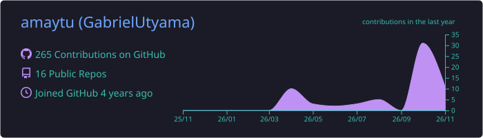
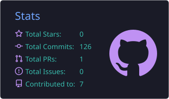
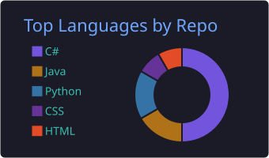

<h1 align="center">Olá, eu sou o Gabriel Utyama 👋</h1>

  

  

---

### 🧑‍💻 Sobre mim

- 💼 Desenvolvedor de software
- 🔭 Trabalhando com aplicações em **C#** e no ecossistema **.NET**
- 🧠 Conhecimento em **TypeScript**, **Node.js**, **Python**, **SQL Server** e **Docker**

---

### 🛠️ Linguagens

  
  
  
  
  
  
  
  

### 🗄️ Banco de dados

  

### 🔧 Versionamento, DevOps e ferramentas

  
  
  
  

---

### 📊 Estatísticas

  

  
  

  

---

  <h3>🐍 Minhas contribuições</h3>
  <picture>
    <source media="(prefers-color-scheme: dark)" srcset="https://raw.githubusercontent.com/amaytu/amaytu/output/github-contribution-grid-snake-dark.svg" />
    <source media="(prefers-color-scheme: light)" srcset="https://raw.githubusercontent.com/amaytu/amaytu/output/github-contribution-grid-snake.svg" />
    
  </picture>

